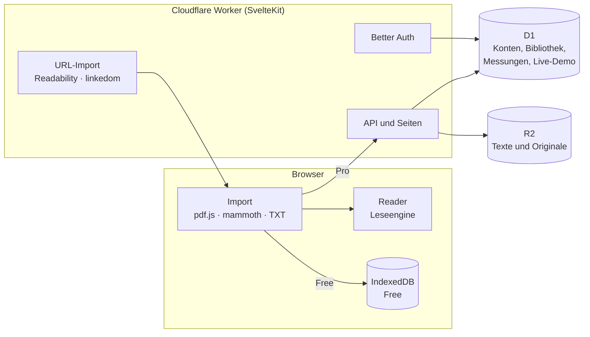

# Prototyp: Aufbau und Funktionen

Stand: 19. Oktober 2026. Dieses Dokument beschreibt, was der Prototyp kann, wie er aufgebaut ist und wie man ihn in der Präsentation vorführt. Produkt und Preise stehen in [`SPEC.md`](../SPEC.md), die Herkunft der Leseengine in [`fovea-sichtung.md`](fovea-sichtung.md).

## Funktionen und Seiten

| Seite                        | Inhalt                                                                                                      |
| ---------------------------- | ----------------------------------------------------------------------------------------------------------- |
| `/`                          | Startseite: Wertversprechen, RSVP-Demo mit steigendem Tempo, Funktionen, Antworten auf die Forschungskritik |
| `/bibliothek`                | Gespeicherte Texte mit Lesefortschritt und Restzeit, für Free bis zu 3, für Pro mit Download des Originals  |
| `/bibliothek/neu`            | Neuer Text: einfügen, Datei hochladen (PDF, DOCX, EPUB, TXT) oder Webartikel per URL importieren            |
| `/lesen/[id]`                | Reader mit ORP, adaptivem Tempo, Satz-Rewind, Chunk-Modus, optischer Anpassung und Volltext                 |
| `/kalibrierung`              | Quiz-Kalibrierung: bis zu sechs Texte von 200 bis 700 WPM, Verständnisgrenze und Veränderung zur letzten    |
| `/preise`                    | Tarife Free, Pro, Business/Edu und Rechner für gesparte Lesestunden                                         |
| `/registrieren`, `/anmelden` | Konto mit E-Mail und Passwort                                                                               |
| `/konto`                     | Tarif wechseln, Browser-Daten ins Konto übernehmen, Auswertung aller Quizantworten (Pro)                    |
| `/praesentation`             | Erste Folie: Das Team stellt sich per RSVP vor, mit 300, 500 und 700 WPM                                    |
| `/live`                      | Live-Demo anlegen oder per Code beitreten                                                                   |
| `/live/[code]`               | Handyansicht für das Publikum: Fragen beantworten, eigenes Ergebnis sehen                                   |
| `/live/[code]/leitung`       | Beameransicht: QR-Code, Text im Tempo der Runde, eingehende Antworten, Ergebnisse, Speed-up-Kurve           |

### Abgleich mit der Spezifikation

| Spezifikation                       | Umsetzung                                                                                                                |
| ----------------------------------- | ------------------------------------------------------------------------------------------------------------------------ |
| Datei-Upload PDF, DOCX, EPUB, TXT   | im Browser mit pdf.js (Legacy-Build), mammoth und eigenem EPUB-Leser; OCR für Scans fehlt noch (Hinweis beim Import)     |
| URL-Scraping                        | Worker lädt die Seite, Readability auf linkedom extrahiert den Artikel                                                   |
| Geschwindigkeit selbst steuern      | Regler 100–1.000 WPM, für Free bis 300 WPM                                                                               |
| Kalibrierung per Quiz               | sechs Texte mit je zwei Fragen, „Weiß ich nicht“ zählt als nicht verstanden                                              |
| Optische Anpassung                  | Schriftart (Serif, Sans, Mono), Hintergrund (Creme, Weiß, Sepia, Nacht), Schriftgröße 28–96 px; Free nur Serif auf Creme |
| Bibliothek mit Lesefortschritt      | Free im Browser (IndexedDB), Pro im Konto (D1 und R2)                                                                    |
| ORP-Hervorhebung                    | Buchstabe nach gemessener Glyphenbreite, auf festem Ankerpunkt                                                           |
| Adaptive Geschwindigkeit            | länger bei langen Wörtern, Zahlen, Satzzeichen und Satzenden, kürzer bei Funktionswörtern                                |
| Satz-Rewind                         | Tipp aufs Wort oder Pfeil links                                                                                          |
| Chunk-Modus                         | 1, 2 oder 3 Wörter pro Frame                                                                                             |
| Präsentation: RSVP-Einstieg         | `/praesentation`                                                                                                         |
| Präsentation: Live-Demo mit QR-Code | `/live`                                                                                                                  |
| Präsentation: Speed-up-Kurve        | Abschluss der Live-Demo; persönliche Kurve in der Auswertung auf `/konto`                                                |

## Tarife im Prototyp

Der Prototyp nimmt kein Geld. Ein Konto wechselt auf `/konto` mit einem Klick zwischen Free und Pro, damit sich beide Tarife vorführen lassen.

| Regel           | Free                               | Pro                                      |
| --------------- | ---------------------------------- | ---------------------------------------- |
| Formate         | eingefügter Text, TXT, PDF, URL    | zusätzlich DOCX und EPUB                 |
| Tempo           | bis 300 WPM                        | bis 1.000 WPM                            |
| Bibliothek      | bis zu 3 Texte                     | unbegrenzt                               |
| Speicherort     | dieser Browser                     | Konto, auf allen Geräten                 |
| Originaldateien | –                                  | in R2, aus der Bibliothek herunterladbar |
| Quiz            | Grenze und Veränderung zur letzten | dazu Kurve und Verlauf auf `/konto`      |
| Darstellung     | Serif auf Creme, Schriftgröße frei | alle Schriften und Hintergründe          |

Die Regeln stehen an einer Stelle, in `src/lib/plan.ts`. Ist die Bibliothek von Free voll, sagt `/bibliothek/neu` das vor dem Import; ein Text, der schon in der Bibliothek liegt, öffnet trotzdem. Misst die Kalibrierung bei Free mehr als 300 WPM, zeigt der Reader das gemessene Tempo und verweist auf Pro. Das ist der Moment, in dem das Produkt seinen Wert selbst belegt.

## Architektur

- **Textextraktion im Browser.** Ein Worker hat 128 MB Arbeitsspeicher und wenig CPU-Zeit pro Anfrage; große PDFs dort zu parsen wäre riskant. Außerdem braucht Free so gar keinen Server. Nur Webartikel lädt der Worker, weil Browser fremde Seiten nicht laden dürfen (CORS).
- **Zwei Bereiche.** Die Startseite in `src/routes/(marketing)` wird beim Build vorgerendert; sie kennt keine Sitzung, deshalb fragt die Kopfzeile dort `/api/auth/get-session` im Browser ab. Bibliothek, Reader und Kalibrierung in `src/routes/(app)` rendern nur im Browser, weil Free Bibliothek, Einstellungen und Leseprofil in IndexedDB hält; das gemeinsame Layout bringt Kopfzeile und Navigation mit.
- **Eine Bibliothek, zwei Speicherorte.** `libraryFor(plan)` in `src/lib/library/index.ts` liefert dieselbe Schnittstelle für IndexedDB und das Konto; Seiten unterscheiden die Tarife nicht.
- **Leseengine ohne Framework.** `src/lib/reader/` ist reines TypeScript (aus Fovea portiert, mit Tests). Die Klasse `Player` treibt die Zustandsmaschine im Takt von `requestAnimationFrame`; Reader, Präsentation und Live-Demo nutzen sie gemeinsam.
- **Server prüft, was Browser schicken.** Textblöcke, Lesefortschritt, Einstellungen, Leseprofil und Kalibrierungsläufe werden mit denselben Funktionen geprüft, die der Browser verwendet. Die Fragetiefe einer Kalibrierung nimmt der Server aus dem Text, nicht aus der Anfrage.

### Import

| Format | Ablauf                                                                                                                                                                                                                                                                                                                |
| ------ | --------------------------------------------------------------------------------------------------------------------------------------------------------------------------------------------------------------------------------------------------------------------------------------------------------------------- |
| PDF    | pdf.js liefert positionierte Textstücke. `pdf-layout.ts` setzt daraus Zeilen, entfernt Kopf- und Fußzeilen und Seitenzahlen, trennt Absätze an größeren Abständen, Schriftgrößenwechseln und kurzen Zeilen mit Satzende und hebt Silbentrennung auf.                                                                  |
| DOCX   | mammoth liefert den Text absatzweise.                                                                                                                                                                                                                                                                                 |
| EPUB   | `zip.ts` entpackt mit dem `DecompressionStream` des Browsers, `epub.ts` folgt `container.xml` und dem Spine der OPF-Datei und liest jedes Kapitel mit `DOMParser`. Inhaltsverzeichnis, Fußnoten und Seitenmarker entfallen; jedes Kapitel endet mit einer Kapitelpause. E-Books mit DRM werden mit Hinweis abgelehnt. |
| TXT    | UTF-8, sonst Windows-1252; Leerzeilen trennen Absätze.                                                                                                                                                                                                                                                                |
| URL    | Der Worker lädt höchstens 5 MB, beachtet den Zeichensatz, Readability findet den Artikel, Fußnotenmarker wie „[2]“ entfallen.                                                                                                                                                                                         |

Das Format erkennt Lector an den ersten Bytes, nicht am Dateinamen; nur DOCX verrät sich als ZIP-Archiv erst durch die Endung. Grenzen: 50 MB pro Datei, 1.000 PDF-Seiten, 5 Mio. Zeichen Text.

## Datenmodell

Das Schema steht in `src/lib/server/db/schema.ts`, die Migrationen in `migrations/`.

| Tabelle                                           | Inhalt                                                                                   |
| ------------------------------------------------- | ---------------------------------------------------------------------------------------- |
| `user`, `session`, `account`, `verification`      | Better Auth; `user.plan` ist `free` oder `pro`                                           |
| `document`                                        | Titel, Format, Quelle, Wortzahl, SHA-256 des Texts, R2-Schlüssel von Modell und Original |
| `progress`                                        | Position, höchste Position, Lesezeit und gelesene Wörter, abgeschlossen am               |
| `reading_settings`                                | Tempo, adaptiv, Chunk-Größe, Schrift, Schriftgröße, Hintergrund                          |
| `calibration`, `measurement`                      | jede Kalibrierung und jeder Lauf mit Tempo und richtigen Antworten                       |
| `reading_profile`                                 | Verständnisgrenze, Verständnisquote, Sicherheit; jede Kalibrierung legt eine Version an  |
| `live_session`, `live_participant`, `live_answer` | Live-Demo: Runden, Phase, Teilnehmende per Zufalls-ID, eine Antwort pro Frage            |

In R2 liegen pro Text `users/<id>/documents/<id>/model.json` (die Textblöcke) und `…/source` (das Original). Derselbe Text wird pro Konto nur einmal gespeichert (SHA-256).

Der Lesefortschritt wächst in einer einzigen SQL-Anweisung (`word_ms = word_ms + ?`), damit zwei Geräte oder überlappende Speichervorgänge keine Lesezeit verlieren.

## API

Alle Endpunkte außer dem URL-Import und der Live-Demo verlangen ein Pro-Konto.

| Methode und Pfad                    | Zweck                                                     |
| ----------------------------------- | --------------------------------------------------------- |
| `POST /api/import/url`              | Webartikel als Absätze (für alle)                         |
| `GET`, `POST /api/documents`        | Bibliothek lesen, Text speichern (Multipart mit Original) |
| `GET`, `DELETE /api/documents/[id]` | Text öffnen, löschen                                      |
| `POST /api/documents/[id]/progress` | Lesefortschritt hinzufügen                                |
| `GET /api/documents/[id]/source`    | Original herunterladen                                    |
| `GET`, `PUT /api/settings`          | Einstellungen                                             |
| `GET`, `POST /api/profile`          | Leseprofil lesen, aus dem Browser übernehmen              |
| `POST /api/calibrations`            | abgeschlossene Kalibrierung speichern                     |
| `GET`, `POST /api/live/[code]`      | Live-Demo abfragen; beitreten, antworten, weiterschalten  |

## Live-Demo in der Präsentation

1. Vorher anmelden und auf `/live` eine Demo anlegen. Vorgabe sind zwei Runden mit 300 und 600 WPM; möglich sind bis zu vier, z. B. „250, 450, 650“ für eine feinere Kurve.
2. `/live/<code>/leitung` auf den Beamer. Das Publikum scannt den QR-Code; die Zahl der Teilnehmenden steht oben rechts.
3. **Runde starten**, dann auf den Text tippen oder die Leertaste drücken. Der Text läuft im Tempo der Runde.
4. **Fragen freigeben**: Die Handys zeigen zwei Fragen. Der Beamer zählt die Antworten mit.
5. **Auswerten**: Anteil richtiger Antworten, Anzahl der Personen mit beiden Antworten richtig und die richtige Antwort pro Frage.
6. Nach der letzten Runde zeigt **Speed-up-Kurve zeigen** das Verständnis des Publikums über dem Tempo. Die Handys zeigen das eigene Ergebnis neben dem des Saals.

Beamer und Handys fragen den Stand alle 1,5 Sekunden ab. Für einen Hörsaal reicht das, und es braucht kein Durable Object. Das Publikum braucht kein Konto. Weiterschalten kann nur die Person, die die Demo angelegt hat, und ein Doppelklick schaltet nur einmal weiter.

Für den Einstieg `/praesentation` öffnen und mit **F** auf Vollbild schalten. Leertaste, Pfeiltasten und ein Präsentations-Klicker (Bild ab/auf) steuern die drei Abschnitte. Die Texte stehen in `src/lib/presentation/intro.ts`.

## Tests

`npm test` prüft die Leseengine, die Kalibrierung, die Bibliotheksregeln, die PDF-Layoutheuristiken, den EPUB-Import, die Artikelextraktion, die serverseitige Prüfung von Kalibrierungsläufen und die Regeln der Live-Demo (206 Tests). Durchgespielt im Browser wurden: Import von PDF, DOCX, TXT und Wikipedia-Artikel, Registrierung, Wechsel zu Pro mit Übernahme der Browser-Bibliothek, Upload und Download des Originals, Kalibrierung mit Speicherung und Auswertung, die Team-Vorstellung und eine Live-Demo mit drei Handys über zwei Runden.

## Bekannte Grenzen

- **Keine Zahlung.** Pro wird per Klick aktiviert; die 7-tägige Testphase und die Preise zeigt nur `/preise`.
- **Kein OCR.** Gescannte PDFs ohne Textebene werden mit Hinweis abgelehnt, Bilder (PNG) lassen sich nicht importieren.
- **Mehrspaltige PDFs** folgen der Reihenfolge im PDF; Foveas Spaltenerkennung ist nicht übernommen.
- **Keine Passwort-Zurücksetzung** und keine E-Mail-Bestätigung; dafür fehlt ein Mailversand.
- **Fragen nur zu den Kalibrierungstexten.** KI-generierte Fragen zu eigenen Texten sind eine Ausbaustufe.
- **Konto löschen** ist nicht umgesetzt; D1 löscht abhängige Zeilen per Kaskade, R2-Objekte lägen unter `users/<id>/`.
